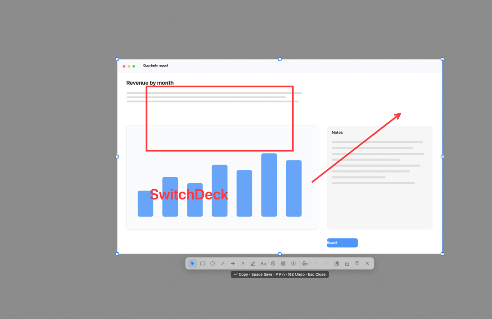

# SwitchDeck

**English** · [繁體中文](README.zh-TW.md)

[](https://github.com/jwcrystal/switchdeck/actions/workflows/ci.yml)
[](https://github.com/jwcrystal/switchdeck/releases)
[](#requirements)
[](LICENSE)

Eighteen Mac settings you would otherwise dig through System Settings or Terminal for — hidden files, Keep Awake, Night Shift, Dark Mode, a keyboard lock for wiping the keys, ejecting disks — each one click away in the menu bar. Plus a screenshot tool that lets you annotate right where you captured, without opening a second window, and on-device text and QR-code recognition.

Native Swift on AppKit and SwiftUI, no third-party dependencies, free and MIT-licensed.

<p align="center"></p>

## Why SwitchDeck

- **One click instead of a Terminal command.** Showing hidden files or hiding desktop icons normally means `defaults write …` followed by `killall Finder`. Here it is a menu row, and the row shows the current state.
- **One menu instead of several apps.** Keep Awake, screen cleaning, quick audio recording and an annotating screenshot tool live in the same menu, so there is less to install and fewer icons in the menu bar.
- **Permissions asked once, in one window.** No dialogs popping up mid-task; a switch that is missing a permission says what is off instead of prompting.
- **Your menu, your order.** Hide the switches you never use and drag the rest into place.
- **Screenshots without switching apps.** Drag a region, mark it up where it is, then `Enter` to copy or `Space` to save.

**Status: pre-1.0 (0.9.0).** Usable day to day, in English and Traditional Chinese. Scrolling capture is paused for now (see [Screenshot editor](#screenshot-editor)), and the settings file format may still change before 1.0.

## Install

### From a release

Needs macOS 14 or later. Download the zip from [Releases](https://github.com/jwcrystal/switchdeck/releases) and move `SwitchDeck.app` to `/Applications`. Releases are built by CI and signed ad-hoc rather than with a paid Apple Developer ID, so macOS blocks the first launch once:

1. Double-click it and click **Done** on the warning.
2. Open System Settings › Privacy & Security, scroll to Security, click **Open Anyway**, then authenticate.
3. Launch it again. From then on it opens normally.

`xattr -dr com.apple.quarantine /Applications/SwitchDeck.app` does the same from a terminal. Right-click → Open stopped working in macOS 15. Because the signature is ad-hoc, an update can ask for the Accessibility, Automation and Screen Recording grants again; a local build avoids that once `scripts/setup-signing.sh` has run (below).

To see whether a newer release is out, choose **Check for Updates…** in the menu. It compares the running version with the latest GitHub release and offers the download page; SwitchDeck never checks on its own.

### Build from source

Needs macOS 14 or later and the Xcode command line tools (`swift --version` should report 5.9 or later).

```bash
git clone https://github.com/jwcrystal/switchdeck.git && cd switchdeck
swift test                      # 159 tests, no UI needed
./scripts/build-app.sh          # builds build/SwitchDeck.app
open build/SwitchDeck.app
```

`./scripts/setup-signing.sh` is optional but worth running once per machine: it creates a locally trusted, self-signed `SwitchDeck Local Signing` certificate, which `build-app.sh` then signs with. Without it, every rebuild changes the ad-hoc CDHash and macOS treats the app as new, so Accessibility and Automation grants are asked for again.

Launch at login needs the app in `/Applications`; until then the toggle in Settings › General reports the system error.

## Switches

| Switch | What it does | Needs |
|---|---|---|
| Show Hidden Files | Shows dotfiles and hidden folders in Finder (Finder restarts) | |
| Hide Desktop Icons | Clears the desktop for a screen share or a screenshot (Finder restarts) | |
| Dock Autohide | Hides the Dock until the pointer reaches the screen edge (the Dock restarts) | |
| Screen Clean | Blacks out every screen and locks the keyboard so both can be wiped | Accessibility |
| Keep Awake | Keeps the Mac from sleeping, indefinitely or for a set time; Keep Display On also stops the screen from turning off | |
| Dark Mode | Switches the system appearance | Automation |
| Mute Sound | Mutes the current output device without touching its volume | |
| Mute Microphone | Mutes the current input device; the menu says "Not available" when the device has no mute | |
| Lock Keyboard | Ignores key presses while you clean; unlocks itself after 5 minutes | Accessibility |
| Lock Screen | Locks the screen immediately | |
| Night Shift | Turns Night Shift on or off | |
| Stage Manager | Turns Stage Manager on or off | |
| Stage Manager Autohide | Hides the Stage Manager strip | |
| Empty Trash | Empties the Trash; the menu shows how many items are in it | Automation |
| Empty Pasteboard | Clears the clipboard | |
| Recording | Records audio from a chosen microphone; elapsed time in the menu | Microphone |
| Screenshot | Region, window, multi-window and full-screen capture with an in-place editor ([below](#screenshot-editor)) | Screen Recording |
| Recognize Text | Select a region or window and read its text or QR code on this Mac; shows the result to edit and copy, or copies straight away with Silent recognition | Screen Recording |
| Quit All Apps | Quits every app except Finder; unsaved work still prompts | |
| Eject Disk | Ejects every removable volume | |

How each one is implemented is listed under [Development](#how-each-switch-works).

Settings › Customize reorders and hides switches; the choice is stored in `~/Library/Application Support/SwitchDeck/config.json`. Rows are dragged into place; a context menu offers Move Up / Move Down / Show in Menu for keyboard use.

Settings › Screenshot gathers everything about a capture — shortcut, delay, colour-readout format, save folder, file-name prefix, image format and signature defaults — Settings › Recognize Text holds the text-recognition shortcut, Silent recognition and Auto copy, and Settings › Recording does the same for audio.

Settings › Recording picks the folder and the microphone. `AVAudioRecorder` only records from the macOS default input, so a chosen microphone becomes the default for as long as a recording runs, and the previous device is restored on stop or quit.

## Screenshot editor

<p align="center"></p>

- `⌥E` starts a capture (installed once as a default; change it in Settings › Screenshot).
- Settings › Screenshot also holds a 0 / 3 / 5 / 10 s delay, the save folder, the file-name prefix, PNG / JPEG / HEIC with a quality slider, the signature text and whether a new capture starts with it, and the starting format for the colour readout. A delayed capture counts down in a small pill and freezes the screen when the clock ends, so a menu or hover state opened during the countdown survives; pressing the shortcut again cancels it.
- Dragging a region enters editing **in place**: the selection stays on screen, everything outside dims, and the toolbar appears under the region — no second window. Clicking a window captures that window alone, with its shadow, instead of whatever happens to be on top of it; `⇧`-click windows to pick several, then `Return` to edit the composed set; `F` selects the whole screen; `R` restores the last region.
- The default tool is Select. With a tool active, dragging inside draws: rectangle, ellipse, line, arrow (straight / curved / elbow), freehand, highlighter, text (S/M/L, optional bubble), numbered markers, mosaic and blur.
- The region keeps its eight handles while editing, so it can still be resized; while dragging, the live screen shows through and the frozen image is refreshed on release.
- While selecting, the colour under the pointer is shown with its value and pixel coordinates; `⌥` cycles HEX / RGB / HSL (the starting format is set in Settings › Screenshot), and `C` copies the value, leaves capture mode and shows a short "Copied …" toast. The readout is hidden once editing starts.
- The region is frozen the moment editing starts, so mosaic and blur preview exactly what gets saved.
- Main tools stay on one row. Selecting a drawing tool reveals a compact horizontal icon row immediately below it: colour, arrow paths (including an S curve), outline/hatched/solid shapes, solid/dashed/dotted strokes, marker shape, text sizes/bubble and sliders for stroke width, pixel-effect strength or highlighter opacity. Clicking the active tool returns to Select and closes the options row.
- With Select, clicking an existing mark edits that object instead of the next one: the options row shows its own colour, stroke, fill, arrow path, text size/bubble or marker shape, changes apply live, and the same values become the default for new marks. Dragging and the eight handles still move or resize it.
- The signature button adds a watermark (the macOS full user name, or the text in Settings › Screenshot); its popover edits the text, colour, position (four corners, centre or a tiled pattern), size (S/M/L), angle (0/30/45°) and opacity. It is clipped to the capture, so a rotated or tiled watermark never spills outside the selection. The eye-slash button hides it from the image but keeps the text in the PNG metadata.
- **Scrolling capture is paused in this build**: the toolbar shows no vertical/horizontal entry, the capture callback and debug route refuse to start it, and the stitching engine stays in the source but cannot be reached from the app. Normal region, window and full-screen capture, annotation, copy, save and pin are unaffected.
- `Enter` copies, `Space` saves an image into the folder and format chosen in Settings › Screenshot (`~/Downloads`, PNG by default) as `SwitchDeck_Screenshot_<date>_<time>`, `P` pins on screen, `⌘Z` / `⇧⌘Z` undo and redo edits, `Esc` closes. A second capture in the same second gets `_2` instead of overwriting.
- Pinned images: the corner × or `Esc` closes, scroll resizes, `⌘`-scroll changes opacity, right-click has Copy / 50% Opacity / Close.

## Permissions

macOS TCC cannot be pre-granted. SwitchDeck shows a **Set up SwitchDeck** window when a permission is missing, and that window is the only place the app triggers a permission dialog:

- **Automation — System Events** — Dark Mode.
- **Automation — Finder** — Empty Trash and its item count.
- **Accessibility** — Lock Keyboard and Screen Clean.
- **Microphone** — Recording.
- **Screen Recording** — Screenshot and Recognize Text; macOS applies the grant after a relaunch.

Grant there once and the menu never prompts again; using a switch with a missing permission just explains what is off. Reopen the window from the menu's **Permissions…** item or Settings › General. Accessibility and Automation status is also listed in Settings › General.

## Development

```bash
build/SwitchDeck.app/Contents/MacOS/SwitchDeck --dump          # every switch + live state
build/SwitchDeck.app/Contents/MacOS/SwitchDeck --run keepAwake # run one switch, print result
build/SwitchDeck.app/Contents/MacOS/SwitchDeck --hotkeys       # register a probe shortcut, report conflicts
build/SwitchDeck.app/Contents/MacOS/SwitchDeck --permissions   # what the app sees for each permission
build/SwitchDeck.app/Contents/MacOS/SwitchDeck --menu          # the menu as it is built
build/SwitchDeck.app/Contents/MacOS/SwitchDeck --capture-test  # capture the main display, report the result
build/SwitchDeck.app/Contents/MacOS/SwitchDeck --editor-demo   # editor over $SWITCHDECK_DEMO_IMAGE, for screenshots
build/SwitchDeck.app/Contents/MacOS/SwitchDeck --ocr-demo      # text recognition over $SWITCHDECK_DEMO_IMAGE
build/SwitchDeck.app/Contents/MacOS/SwitchDeck --audio-inputs  # microphones CoreAudio offers, default marked
build/SwitchDeck.app/Contents/MacOS/SwitchDeck --timed-demo    # run the 3 s delayed capture for a visual check
```

```
Sources/SwitchKit/             # no AppKit UI, unit-testable
  SwitchItem.swift             # one menu row: title, icon, state, action, submenu
  SwitchCatalog.swift          # the built-in switches
  Config.swift                 # order, visibility and shortcuts, JSON persistence
  HotkeyBinding.swift          # key + Carbon modifiers + key-cap label
  Shell.swift / Automation.swift
  Switches/                    # one file per switch
Sources/SwitchDeckApp/         # AppKit shell
  MenuController.swift         # NSStatusItem + NSMenu, rebuilt on config change
  HotkeyCenter.swift           # Carbon registration, conflict reporting
  HotkeyRecorder.swift         # NSEvent -> binding, local capture monitor
  SettingsView.swift           # SwiftUI settings
  Screenshot/                  # capture, in-place editor, annotations, scrolling engine
Tests/SwitchKitTests/          # switches, config, hotkeys, Trash counting
Tests/ScreenshotTests/         # annotation history, styles, scrolling and stitching maths
```

### How each switch works

| Switch | How it works | Note |
|---|---|---|
| Show Hidden Files | `defaults write com.apple.finder AppleShowAllFiles` + Finder restart | Finder restarts |
| Hide Desktop Icons | `defaults write com.apple.finder CreateDesktop` + Finder restart | Finder restarts; menu says "Icons hidden" |
| Dock Autohide | `defaults write com.apple.dock autohide` + `killall Dock` | launchd restarts the Dock |
| Screen Clean | Black overlay on every screen at screen-saver level + keyboard lock | Click once to reveal Stop Clean |
| Keep Awake | `ProcessInfo.beginActivity` (adds `.idleDisplaySleepDisabled` with Keep Display On), optional duration and expiry in the menu | Shown in `pmset -g assertions` |
| Dark Mode | System Events appearance preferences | Needs Automation |
| Mute Sound / Mute Microphone | Core Audio `kAudioDevicePropertyMute` on the default output or input device, falling back to per-channel mute | Volume is never zeroed; a device with no settable mute shows "Not available" |
| Lock Keyboard | `CGEventTap` swallowing key events, auto-unlocks after 5 min | Needs Accessibility |
| Lock Screen | private `SACLockScreenImmediate` from `login.framework` | Falls back to ⌃⌘Q via System Events |
| Night Shift | private `CBBlueLightClient` from `CoreBrightness` (`dlopen`) | No public API; verified on macOS 27 |
| Stage Manager | `com.apple.WindowManager GloballyEnabled` + WindowManager restart | Key name needs a visual check on this Mac |
| Stage Manager Autohide | `com.apple.WindowManager AutoHide` + restart | Same |
| Empty Trash | Finder AppleScript: `count items in trash`, `empty trash` | Needs Automation; direct `~/.Trash` reads are blocked by TCC |
| Empty Pasteboard | `NSPasteboard.clearContents()` | |
| Recording | `AVAudioRecorder` to the folder chosen in Settings › Recording (default `~/Music/SwitchDeck`), with a microphone picker; elapsed time in the menu | Needs Microphone |
| Screenshot | ScreenCaptureKit region, single-window, multi-window and full-screen capture; borderless editor with rectangle, ellipse, line, arrow, pen, highlighter, text, numbering, mosaic and blur; copy, save, pin | Needs Screen Recording; scrolling capture is paused |
| Recognize Text | Same overlay as Screenshot, finishing on selection; Vision `VNRecognizeTextRequest` (accurate, language detection, Traditional/Simplified Chinese, English, Japanese, Korean) and `VNDetectBarcodesRequest` | Runs on device; a QR code wins over surrounding text |
| Quit All Apps | `NSRunningApplication.terminate()`, skips Finder and SwitchDeck | Unsaved work still prompts |
| Eject Disk | `NSWorkspace.unmountAndEjectDevice`, counts removable volumes | |

Adding a switch is one `SwitchItem` plus one class; `docs/adding-a-switch.md` walks through it.

The designated requirement the signature keeps stable across rebuilds is:

```
identifier "io.github.jwcrystal.switchdeck" and certificate leaf = H"…"
```

Verify with `codesign -d -r- build/SwitchDeck.app`.

## Not on the App Store

SwitchDeck cannot ship on the Mac App Store in this form, and does not try to:

- It uses private APIs (`SACLockScreenImmediate`, `CBBlueLightClient`), which App Review rejects outright.
- It is not sandboxed and drives Finder and System Events through Apple Events.
- Lock Keyboard is a `CGEventTap` that swallows every key event.
- It has no App Store identifier, no entitlement set and no team signing.
- Private APIs can break on any macOS update; a failing switch degrades to an explanation rather than a crash, but no release here promises otherwise.

Releases attach a CI-built zip, ad-hoc signed, so the first launch needs **Open Anyway** (see [Install](#from-a-release)). Build from source instead if you would rather sign it with your own identity, or notarize a Developer ID build before handing it to someone else.

## Localisation

The interface ships in English and Traditional Chinese (Taiwan). English wording in the source doubles as the key; `Resources/zh-Hant.lproj/Localizable.strings` holds the translations, and `scripts/build-app.sh` copies every `.lproj` into the bundle. `./scripts/check-localizations.sh` fails when a `t()` key has no entry or a translation drops a `%@`/`%d` placeholder. A language with no file simply shows English. Settings › General › Language overrides the choice for the app itself — system, English or 繁體中文 — and offers a relaunch, since macOS resolves a bundle's language once at launch.

## Similar projects

[AnySwitch](https://apps.apple.com/us/app/anyswitch-powerful-switches/id6444313776) (anyfun.studio, Mac App Store) and [OnlySwitch](https://github.com/jacklandrin/OnlySwitch) (MIT) cover much of the same ground. OnlySwitch is broader and still maintained; AnySwitch has had no release since September 2023. The three are independent, with no shared code. SwitchDeck takes a different line: a short, flat native menu rather than a large catalogue, a local build outside the sandbox, and one `SwitchItem` per switch. `docs/COMPARISON.md` has a side-by-side as of November 2026, wins and losses included.

## License

[MIT](LICENSE). Copyright © 2026 Jared Wang.
