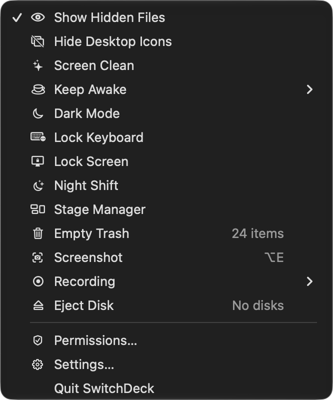

# SwitchDeck

A macOS menu-bar app with sixteen one-click system switches and a built-in screenshot editor. Native Swift on AppKit and SwiftUI, built from source with SwiftPM, no third-party dependencies, no App Store sandbox.

<p align="center"></p>

**Status: pre-1.0 (0.7.2).** The switches and the menu are settled; the screenshot editor works for region, window and full-screen capture, and its scrolling capture is paused (see below). Expect rough edges and direct API changes.

## Requirements

- macOS 14 or later
- Xcode command line tools (`swift --version` should report 5.9 or later)

## Build and run

```bash
git clone <this repository> switchdeck && cd switchdeck
swift test                      # 84 tests, no UI needed
./scripts/build-app.sh          # builds build/SwitchDeck.app
open build/SwitchDeck.app
```

`./scripts/setup-signing.sh` is optional but worth running once per machine: it creates a locally trusted, self-signed `SwitchDeck Local Signing` certificate, which `build-app.sh` then signs with. Without it, every rebuild changes the ad-hoc CDHash and macOS treats the app as new, so Accessibility and Automation grants are asked for again.

Launch at login needs the app in `/Applications`; until then the toggle in Settings › General reports the system error.

## Switches

| Switch | How it works | Note |
|---|---|---|
| Show Hidden Files | `defaults write com.apple.finder AppleShowAllFiles` + Finder restart | Finder restarts |
| Hide Desktop Icons | `defaults write com.apple.finder CreateDesktop` + Finder restart | Finder restarts; menu says "Icons hidden" |
| Screen Clean | Black overlay on every screen at screen-saver level + keyboard lock | Click once to reveal Stop Clean |
| Keep Awake | `ProcessInfo.beginActivity`, optional duration and expiry in the menu | Shown in `pmset -g assertions` |
| Dark Mode | System Events appearance preferences | Needs Automation |
| Lock Keyboard | `CGEventTap` swallowing key events, auto-unlocks after 5 min | Needs Accessibility |
| Lock Screen | private `SACLockScreenImmediate` from `login.framework` | Falls back to ⌃⌘Q via System Events |
| Night Shift | private `CBBlueLightClient` from `CoreBrightness` (`dlopen`) | No public API; verified on macOS 27 |
| Stage Manager | `com.apple.WindowManager GloballyEnabled` + WindowManager restart | Key name needs a visual check on this Mac |
| Stage Manager Autohide | `com.apple.WindowManager AutoHide` + restart | Same |
| Empty Trash | Finder AppleScript: `count items in trash`, `empty trash` | Needs Automation; direct `~/.Trash` reads are blocked by TCC |
| Empty Pasteboard | `NSPasteboard.clearContents()` | |
| Recording | `AVAudioRecorder` to `~/Music/SwitchDeck`, elapsed time in the menu | Needs Microphone |
| Screenshot | ScreenCaptureKit region/window/full-screen capture; borderless editor with rectangle, ellipse, line, arrow, pen, highlighter, text, numbering, mosaic and blur; copy, save, pin | Needs Screen Recording; scrolling capture is paused |
| Quit All Apps | `NSRunningApplication.terminate()`, skips Finder and SwitchDeck | Unsaved work still prompts |
| Eject Disk | `NSWorkspace.unmountAndEjectDevice`, counts removable volumes | |

Settings › Customize reorders and hides switches; the choice is stored in `~/Library/Application Support/SwitchDeck/config.json`. Rows are dragged into place; a context menu offers Move Up / Move Down / Show in Menu for keyboard use.

## Screenshot editor

- `⌥E` starts a capture (installed once as a default; change it in Settings › Shortcuts).
- Dragging a region enters editing **in place**: the selection stays on screen, everything outside dims, and the toolbar appears under the region — no second window. Clicking a window edits at that window's frame; `F` selects the whole screen; `R` restores the last region.
- The default tool is Select. With a tool active, dragging inside draws: rectangle, ellipse, line, arrow (straight / curved / elbow), freehand, highlighter, text (S/M/L, optional bubble), numbered markers, mosaic and blur.
- The region keeps its eight handles while editing, so it can still be resized; while dragging, the live screen shows through and the frozen image is refreshed on release.
- While selecting, the colour under the pointer is shown with its value and pixel coordinates; `⌥` cycles HEX / RGB / HSL, and `C` copies the value, leaves capture mode and shows a short "Copied …" toast. The readout is hidden once editing starts.
- The region is frozen the moment editing starts, so mosaic and blur preview exactly what gets saved.
- Main tools stay on one row. Selecting a drawing tool reveals a compact horizontal icon row immediately below it: colour, arrow paths (including an S curve), outline/hatched/solid shapes, solid/dashed/dotted strokes, marker shape, text sizes/bubble and sliders for stroke width, pixel-effect strength or highlighter opacity. Clicking the active tool returns to Select and closes the options row.
- With Select, clicking an existing mark edits that object instead of the next one: the options row shows its own colour, stroke, fill, arrow path, text size/bubble or marker shape, changes apply live, and the same values become the default for new marks. Dragging and the eight handles still move or resize it.
- The signature button adds a watermark (the macOS full user name); its popover edits the text, colour, position (four corners, centre or a tiled pattern), size (S/M/L), angle (0/30/45°) and opacity. It is clipped to the capture, so a rotated or tiled watermark never spills outside the selection. The eye-slash button hides it from the image but keeps the text in the PNG metadata.
- **Scrolling capture is paused in this build**: the toolbar shows no vertical/horizontal entry, the capture callback and debug route refuse to start it, and the stitching engine stays in the source but cannot be reached from the app. Normal region, window and full-screen capture, annotation, copy, save and pin are unaffected.
- `Enter` copies, `Space` saves a PNG straight into `~/Downloads` as `SwitchDeck Screenshot <date>.png` (folder and prefix are the UserDefaults keys that Settings will expose), `P` pins on screen, `⌘Z` / `⇧⌘Z` undo and redo edits, `Esc` closes.
- Pinned images: the corner × or `Esc` closes, scroll resizes, `⌘`-scroll changes opacity, right-click has Copy / 50% Opacity / Close.

## Permissions

macOS TCC cannot be pre-granted. SwitchDeck shows a **Set up SwitchDeck** window when a permission is missing, and that window is the only place the app triggers a permission dialog:

- **Automation — System Events** — Dark Mode.
- **Automation — Finder** — Empty Trash and its item count.
- **Accessibility** — Lock Keyboard and Screen Clean.
- **Microphone** — Recording.
- **Screen Recording** — Screenshot; macOS applies the grant after a relaunch.

Grant there once and the menu never prompts again; using a switch with a missing permission just explains what is off. Reopen the window from the menu's **Permissions…** item or Settings › General. Accessibility and Automation status is also listed in Settings › General.

## Development

```bash
build/SwitchDeck.app/Contents/MacOS/SwitchDeck --dump          # every switch + live state
build/SwitchDeck.app/Contents/MacOS/SwitchDeck --run keepAwake # run one switch, print result
build/SwitchDeck.app/Contents/MacOS/SwitchDeck --hotkeys       # register a probe shortcut, report conflicts
build/SwitchDeck.app/Contents/MacOS/SwitchDeck --permissions   # what the app sees for each permission
build/SwitchDeck.app/Contents/MacOS/SwitchDeck --menu          # the menu as it is built
build/SwitchDeck.app/Contents/MacOS/SwitchDeck --capture-test  # capture the main display, report the result
```

```
Sources/SwitchKit/             # no AppKit UI, unit-testable
  SwitchItem.swift             # one menu row: title, icon, state, action, submenu
  SwitchCatalog.swift          # the built-in switches
  Config.swift                 # order, visibility and shortcuts, JSON persistence
  HotkeyBinding.swift          # key + Carbon modifiers + key-cap label
  Shell.swift / Automation.swift
  Switches/                    # one file per switch
Sources/SwitchDeckApp/         # AppKit shell
  MenuController.swift         # NSStatusItem + NSMenu, rebuilt on config change
  HotkeyCenter.swift           # Carbon registration, conflict reporting
  HotkeyRecorder.swift         # NSEvent -> binding, local capture monitor
  SettingsView.swift           # SwiftUI settings
  Screenshot/                  # capture, in-place editor, annotations, scrolling engine
Tests/SwitchKitTests/          # switches, config, hotkeys, Trash counting
Tests/ScreenshotTests/         # annotation history, styles, scrolling and stitching maths
scripts/build-app.sh           # SPM binary -> .app with Info.plist + local signature
```

The designated requirement the signature keeps stable across rebuilds is:

```
identifier "io.github.jwcrystal.switchdeck" and certificate leaf = H"…"
```

Verify with `codesign -d -r- build/SwitchDeck.app`.

`docs/internal/` holds the working notes written while building the screenshot editor. They are kept for traceability, not as documentation — some reference plan files that were never committed.

## Not on the App Store

SwitchDeck cannot ship on the Mac App Store in this form, and does not try to:

- It uses private APIs (`SACLockScreenImmediate`, `CBBlueLightClient`), which App Review rejects outright.
- It is not sandboxed and drives Finder and System Events through Apple Events.
- Lock Keyboard is a `CGEventTap` that swallows every key event.
- It has no App Store identifier, no entitlement set and no team signing.
- Private APIs can break on any macOS update; a failing switch degrades to an explanation rather than a crash, but no release here promises otherwise.

Distribution is source-only for now: build it yourself, or notarize your own Developer ID build if you want to hand it to someone else.

## Similar projects

[AnySwitch](https://apps.apple.com/us/app/anyswitch-powerful-switches/id6444313776) (anyfun.studio, Mac App Store) and [OnlySwitch](https://github.com/jacklandrin/OnlySwitch) (MIT) cover much of the same ground; OnlySwitch is the broader and more mature one. No code is shared with either. `docs/COMPARISON.md` has a factual side-by-side, written as a snapshot in November 2026.

## License

[MIT](LICENSE). Copyright © 2026 Jared Wang.
