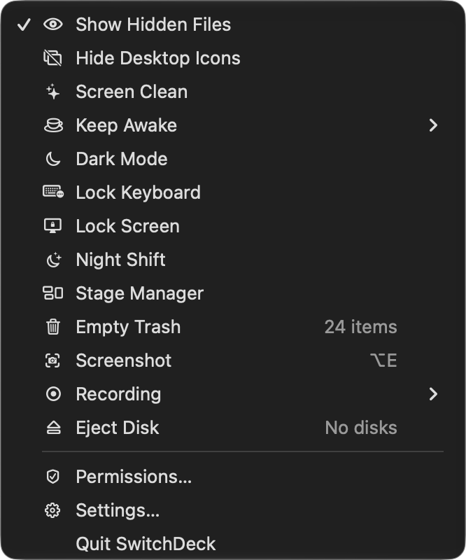
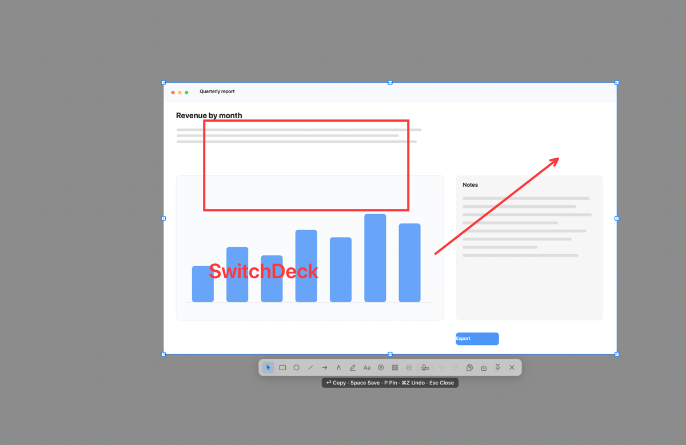

# SwitchDeck

[English](README.md) · **繁體中文**

macOS 選單列小工具：16 個一鍵系統開關，加上一個內建的截圖編輯器。原生 Swift（AppKit + SwiftUI），以 SwiftPM 從原始碼建置，沒有第三方相依，沒有 App Store 沙盒。

<p align="center"></p>

**狀態：pre-1.0（0.7.2）。** 開關與選單已定案；介面有英文與繁體中文；截圖編輯器可用於區域、視窗與全螢幕擷取，滾動截圖暫停（見下）。預期會有粗糙邊角與直接變動的 API。

## 需求

- macOS 14 以上
- Xcode 命令列工具（`swift --version` 應顯示 5.9 以上）

## 建置與執行

```bash
git clone <本專案網址> switchdeck && cd switchdeck
swift test                      # 93 個測試，不需要 UI
./scripts/build-app.sh          # 產出 build/SwitchDeck.app
open build/SwitchDeck.app
```

`./scripts/setup-signing.sh` 可選，但每台機器值得跑一次：它會建立本機信任的自簽憑證 `SwitchDeck Local Signing`，`build-app.sh` 之後就自動用它簽章。沒有它，每次重建都會換一個 ad-hoc CDHash，macOS 會把每次建置當成新 app，於是輔助使用與自動化權限每次都要重新詢問。

開機自動啟動需要把 app 放進 `/Applications`；在那之前，設定 › 一般裡的開關會顯示系統錯誤。

### 從 release zip 安裝

release 由 CI 建置、ad-hoc 簽章，所以 macOS 會擋第一次啟動。把 `SwitchDeck.app` 放進 `/Applications` 後：

1. 點兩下開啟，警告視窗按 **Done**。
2. 打開系統設定 › 隱私權與安全性，捲到「安全性」，按 **仍要打開**，然後驗證身份。
3. 再啟動一次。

也可以在終端機執行 `xattr -dr com.apple.quarantine /Applications/SwitchDeck.app`。macOS 15 之後右鍵→打開已經無效。因為簽章是 ad-hoc 而不是 Developer ID，更新後可能會再問一次輔助使用、自動化與螢幕錄製權限；自己在本機建置並跑過 `scripts/setup-signing.sh` 就不會。

## 開關

| 開關 | 怎麼實作 | 備註 |
|---|---|---|
| 顯示隱藏檔 | `defaults write com.apple.finder AppleShowAllFiles` + 重啟 Finder | Finder 會重啟 |
| 隱藏桌面圖示 | `defaults write com.apple.finder CreateDesktop` + 重啟 Finder | Finder 會重啟；選單顯示「Icons hidden」 |
| 螢幕清潔 | 每個螢幕覆蓋一層螢幕保護程式層級的黑幕 + 鎖定鍵盤 | 點一下叫出「停止清潔」 |
| 保持清醒 | `ProcessInfo.beginActivity`，可選時長，選單顯示到期時間 | 可用 `pmset -g assertions` 查到 |
| 深色模式 | 透過 System Events 改外觀偏好 | 需要自動化權限 |
| 鎖定鍵盤 | `CGEventTap` 吞掉按鍵事件，5 分鐘後自動解鎖 | 需要輔助使用權限 |
| 鎖定螢幕 | `login.framework` 的私有 API `SACLockScreenImmediate` | 失敗時退回 System Events 的 ⌃⌘Q |
| 夜覽（Night Shift） | `CoreBrightness` 的私有 API `CBBlueLightClient`（`dlopen`） | 沒有公開 API；已在 macOS 27 驗證 |
| 幕前調度 | `com.apple.WindowManager GloballyEnabled` + 重啟 WindowManager | 鍵名需要在實機目視確認 |
| 幕前調度自動隱藏 | `com.apple.WindowManager AutoHide` + 重啟 | 同上 |
| 清空垃圾桶 | Finder AppleScript：`count items in trash`、`empty trash` | 需要自動化權限；TCC 會擋掉直接讀 `~/.Trash` |
| 清空剪貼簿 | `NSPasteboard.clearContents()` | |
| 錄音 | `AVAudioRecorder` 存到設定 › 錄音選的資料夾（預設 `~/Music/SwitchDeck`），可選麥克風；選單顯示已錄時間 | 需要麥克風權限 |
| 截圖 | `ScreenCaptureKit` 擷取區域／視窗／全螢幕；無邊框就地編輯器，支援矩形、橢圓、直線、箭頭、畫筆、螢光筆、文字、編號、馬賽克與模糊；延遲擷取、HEX／RGB／HSL 讀值、PNG／JPEG／HEIC 儲存；可複製、儲存、釘選 | 需要螢幕錄製權限；滾動截圖暫停 |
| 結束所有 App | `NSRunningApplication.terminate()`，跳過 Finder 與 SwitchDeck | 未儲存的工作仍會跳出詢問 |
| 退出磁碟 | `NSWorkspace.unmountAndEjectDevice`，計數可卸除的卷宗 | |

設定 › 自訂可以調整順序與隱藏開關，選擇存在 `~/Library/Application Support/SwitchDeck/config.json`。列可以拖曳排序；右鍵選單提供「上移／下移／在選單中顯示」給鍵盤操作。

設定 › 截圖集中了擷取的所有設定：快速鍵、延遲、取色格式、儲存資料夾、檔名前綴、影像格式與簽名預設；設定 › 錄音則集中處理音訊。

設定 › 錄音決定資料夾與麥克風。`AVAudioRecorder` 只能從 macOS 預設輸入錄音，所以選定的麥克風會在錄音期間成為預設，停止或結束 App 時再還原上一個裝置。

## 截圖編輯器

<p align="center"></p>

- `⌥E` 開始擷取（預設安裝一次；可在設定 › 截圖更改）。
- 設定 › 截圖還放著 0／3／5／10 秒延遲、儲存資料夾、檔名前綴、PNG／JPEG／HEIC 與品質滑桿、簽名文字與「新擷取預設帶簽名」，以及取色讀值的起始格式。延遲擷取會以小膠囊倒數，時間到才凍結畫面，所以倒數期間打開的選單或滑鼠停留狀態會留下來；再按一次快速鍵即取消。
- 拖出區域後**就地**進入編輯：選取範圍留在畫面上、範圍外變暗、工具列出現在選取區下方，不開第二個視窗。點視窗即以該視窗框為範圍編輯；`F` 選整個螢幕；`R` 還原上次的區域。
- 預設工具是「選取」。選了工具後在範圍內拖曳即可畫：矩形、橢圓、直線、箭頭（直線／曲線／折線）、手繪、螢光筆、文字（S／M／L，可加氣泡）、編號標記、馬賽克與模糊。
- 編輯期間選取區仍保留八個控制點，可以繼續調整大小；拖曳時畫面是即時的，放開後才更新凍結的影像。
- 選取時顯示指標下的顏色值與像素座標；`⌥` 在 HEX／RGB／HSL 之間切換（起始格式在設定 › 截圖），`C` 複製色值、離開擷取模式並顯示短暫的「已複製…」提示。開始編輯後不再顯示。
- 開始編輯的瞬間影像就凍結，所以馬賽克與模糊預覽的就是存下來的結果。
- 主要工具維持一列。選了繪圖工具，下方立刻出現一列緊湊的圖示選項：顏色、箭頭路徑（含 S 曲線）、輪廓／斜線／實心、實線／虛線／點線、標記形狀、文字大小／氣泡，以及筆畫寬度、像素效果強度或螢光筆不透明度的滑桿。再點一次使用中的工具會回到「選取」並收起選項列。
- 在「選取」模式下點既有標記是編輯那個物件，而不是繼續新增：選項列會顯示它自己的顏色、筆畫、填色、箭頭路徑、文字大小／氣泡或標記形狀，改了立即生效，同樣的值也成為新標記的預設。拖曳與八個控制點仍可移動或縮放它。
- 簽名按鈕加上浮水印（macOS 使用者全名，或設定 › 截圖裡的文字）；彈出面板可改文字、顏色、位置（四角、置中或平鋪）、大小（S／M／L）、角度（0／30／45°）與不透明度。浮水印會被裁在擷取範圍內，旋轉或平鋪都不會溢出。眼睛斜線按鈕把它從影像隱藏，但文字仍留在 PNG 中介資料裡。
- **這一版暫停滾動截圖**：工具列沒有垂直／水平入口，擷取回呼與除錯路徑都拒絕啟動，拼接引擎還留在原始碼裡但從 app 到不了。一般的區域、視窗與全螢幕擷取、標註、複製、儲存、釘選都不受影響。
- `Enter` 複製，`Space` 依設定 › 截圖選的資料夾與格式存檔（預設 `~/Downloads`、PNG），檔名 `SwitchDeck_Screenshot_<日期>_<時間>`，`P` 釘在畫面上，`⌘Z`／`⇧⌘Z` 復原與重做，`Esc` 關閉。同一秒連拍會多出 `_2`，不會蓋掉前一張。
- 釘選的圖：角落 × 或 `Esc` 關閉，滾輪縮放，`⌘`+滾輪改不透明度，右鍵有複製／50% 不透明度／關閉。

## 權限

macOS 的 TCC 無法預先授予。缺少權限時 SwitchDeck 會顯示「設定 SwitchDeck」視窗，那個視窗也是 app 唯一會觸發系統權限對話框的地方：

- **自動化 — System Events** — 深色模式。
- **自動化 — Finder** — 清空垃圾桶與項目計數。
- **輔助使用** — 鎖定鍵盤與螢幕清潔。
- **麥克風** — 錄音。
- **螢幕錄製** — 截圖；macOS 會在重新啟動後套用授權。

在那裡授予一次，之後選單不會再問；用到缺權限的開關時只會說明缺什麼。可從選單的「權限…」或設定 › 一般重新打開那個視窗。設定 › 一般也會列出輔助使用與自動化的狀態。

## 開發

```bash
build/SwitchDeck.app/Contents/MacOS/SwitchDeck --dump          # 每個開關 + 即時狀態
build/SwitchDeck.app/Contents/MacOS/SwitchDeck --run keepAwake # 執行單一開關並印出結果
build/SwitchDeck.app/Contents/MacOS/SwitchDeck --hotkeys       # 註冊測試快速鍵，回報衝突
build/SwitchDeck.app/Contents/MacOS/SwitchDeck --permissions   # app 看到的每個權限狀態
build/SwitchDeck.app/Contents/MacOS/SwitchDeck --menu          # 建出來的選單長怎樣
build/SwitchDeck.app/Contents/MacOS/SwitchDeck --capture-test  # 擷取主螢幕並回報結果
build/SwitchDeck.app/Contents/MacOS/SwitchDeck --editor-demo   # 用 $SWITCHDECK_DEMO_IMAGE 當背景開編輯器，供截圖用
build/SwitchDeck.app/Contents/MacOS/SwitchDeck --audio-inputs  # CoreAudio 看到的麥克風，標出預設
build/SwitchDeck.app/Contents/MacOS/SwitchDeck --timed-demo    # 跑一次 3 秒延遲擷取，方便目視檢查
```

```
Sources/SwitchKit/             # 沒有 AppKit UI，可單元測試
  SwitchItem.swift             # 一列選單：標題、圖示、狀態、動作、子選單
  SwitchCatalog.swift          # 內建開關
  Config.swift                 # 順序、可見性與快速鍵，JSON 持久化
  HotkeyBinding.swift          # 按鍵 + Carbon 修飾鍵 + 鍵帽標籤
  Shell.swift / Automation.swift
  Switches/                    # 一個開關一個檔
Sources/SwitchDeckApp/         # AppKit 外殼
  MenuController.swift         # NSStatusItem + NSMenu，設定變更時重建
  HotkeyCenter.swift           # Carbon 註冊、衝突回報
  HotkeyRecorder.swift         # NSEvent -> binding，本機擷取監聽
  SettingsView.swift           # SwiftUI 設定
  Screenshot/                  # 擷取、就地編輯器、標註、滾動引擎
Tests/SwitchKitTests/          # 開關、設定、快速鍵、垃圾桶計數
Tests/ScreenshotTests/         # 標註歷史、樣式、滾動與拼接數學
scripts/build-app.sh           # SPM binary -> .app，附 Info.plist 與本機簽章
```

簽章在重建之間保持穩定的 designated requirement 是：

```
identifier "io.github.jwcrystal.switchdeck" and certificate leaf = H"…"
```

用 `codesign -d -r- build/SwitchDeck.app` 驗證。

`docs/internal/` 放的是截圖編輯器開發期間的工作紀錄。留著是為了可追溯，不是文件——裡面引用的一些計畫檔當年就沒提交。

## 不會上 App Store

SwitchDeck 以現在的形式無法上 Mac App Store，也沒有試：

- 用了私有 API（`SACLockScreenImmediate`、`CBBlueLightClient`），App Review 會直接退。
- 沒有沙盒，透過 Apple Events 驅動 Finder 與 System Events。
- 鎖定鍵盤是吞掉所有按鍵事件的 `CGEventTap`。
- 沒有 App Store 用的識別碼、entitlement 或團隊簽章。
- 私有 API 可能在任一次 macOS 更新後壞掉；壞掉的開關會退化成一句說明而不是 crash，但這個 repo 不承諾別的。

release 會附上 CI 建置的 zip（ad-hoc 簽章），第一次啟動需要按「仍要打開」（見「建置與執行」）。想自己簽章就用原始碼建置；要交給別人則建議用 Developer ID 簽章並 notarize。

## 多語系

介面提供英文與繁體中文（台灣）。原始碼裡的英文字面就是 key，翻譯放在 `Resources/zh-Hant.lproj/Localizable.strings`，`scripts/build-app.sh` 會把每個 `.lproj` 複製進 bundle。`./scripts/check-localizations.sh` 會在 `t()` 的 key 沒有條目、或翻譯漏掉 `%@`／`%d` 佔位符時失敗。沒有對應語言檔就顯示英文。設定 › 一般 › 語言可以覆寫 app 自己的語言（系統、English、繁體中文）；macOS 只在啟動時決定 bundle 的語言，所以切換後會提供重新啟動。

## 類似專案

[AnySwitch](https://apps.apple.com/us/app/anyswitch-powerful-switches/id6444313776)（anyfun.studio，Mac App Store）與 [OnlySwitch](https://github.com/jacklandrin/OnlySwitch)（MIT）涵蓋的範圍大致重疊；OnlySwitch 功能更廣、也更成熟。三者沒有共用程式碼。`docs/COMPARISON.md` 有 2026 年 11 月的並排比較。

## 授權

[MIT](LICENSE)。Copyright © 2026 Jared Wang。
